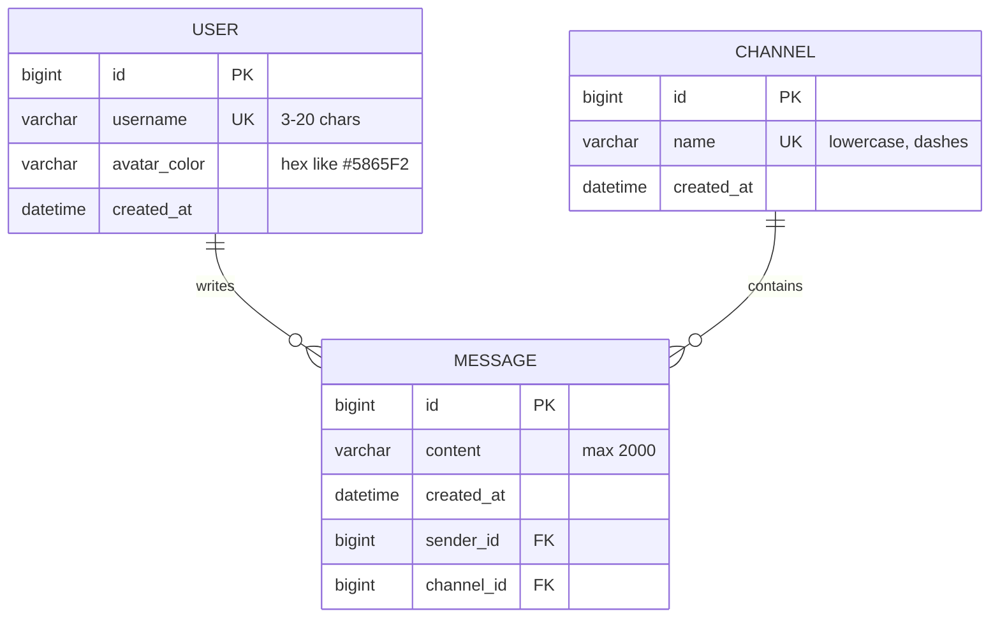

# ChatApp — Real-Time Channel-Based Chat

A Discord-inspired chat application built for a 4th-year college mini project. Users pick a
username, join channels, and exchange messages in real time over WebSocket — with typing
indicators, live online-user presence, and message history.

## Tech Stack

| Layer    | Technology |
|----------|------------|
| Frontend | React 18, Vite, React Router 6, Axios, Tailwind CSS 4, @stomp/stompjs + sockjs-client |
| Backend  | Java 17, Spring Boot 3.5, Spring Web, Spring Data JPA, Spring WebSocket (STOMP over SockJS), Bean Validation, Lombok |
| Database | H2 (file-based, zero setup) — commented MySQL config included |
| Tests    | JUnit 5, Mockito, MockMvc (backend) · Playwright browser tests (frontend) |

## Features

- **Simple login** — enter a username and pick an avatar color; the backend creates the user on
  first login and reuses it afterwards. No passwords.
- **Channels** — seeded with `#general`, `#random`, `#tech-talk`; users can create and delete
  channels. Channel changes broadcast to everyone instantly.
- **Real-time messaging** — messages travel over STOMP/WebSocket and are persisted to the DB.
- **Message history** — opening a channel loads the latest 50 messages via REST.
- **Delete your own message** — ownership is enforced server-side; the deletion broadcasts live.
- **Typing indicators** — “Alex is typing...”, throttled client-side, expires after a few seconds.
- **Online users** — the right panel updates in real time as users connect and disconnect.

## Architecture

The backend follows a classic layered architecture (this is the graded structure):

```
Controller  →  Service  →  Repository  →  Database
   ↑             ↑ (DTO mapping + business rules + broadcast via ChatBroadcaster)
WebSocket ────────┘
```

```
backend/src/main/java/com/example/chatapp/
├── config/        WebSocketConfig, CorsConfig, DataSeeder (first-run seed)
├── controller/    REST controllers (users, channels, messages, presence)
├── service/       UserService, ChannelService, MessageService, PresenceService
├── repository/    Spring Data JPA interfaces
├── entity/        User, Channel, Message (JPA)
├── dto/           Request/response payloads with validation annotations
├── exception/     GlobalExceptionHandler (@RestControllerAdvice) + error types
└── websocket/     ChatWebSocketController, ChatBroadcaster, PresenceEventListener

frontend/src/
├── api/           Axios client + endpoint functions
├── components/    Sidebar, messages, input, modal, panels, ...
├── context/       AuthContext (user + localStorage), ToastContext
├── hooks/         useWebSocket (one reusable STOMP connection)
└── pages/         LoginPage, ChatPage
```

Design notes:

- **Entities are never serialized directly** — every service maps to DTOs, which avoids
  lazy-loading JSON problems (`spring.jpa.open-in-view=false` is safe because queries use
  `JOIN FETCH`).
- **One WebSocket connection** lives in `useWebSocket`; it re-subscribes when you switch
  channels and always unsubscribes the previous topics first (no duplicate handlers), and
  auto-reconnects with a 4s delay.
- **Presence** is tracked per WebSocket session on the server; the initial list is fetched via
  `GET /api/presence` and kept fresh through `/topic/presence`.

## Entity-Relationship Diagram



## REST API

Base URL: `http://localhost:8080/api` — CORS enabled for `http://localhost:5173`.

| Method | Endpoint                      | Body / Params                        | Returns            | Description |
|--------|-------------------------------|--------------------------------------|--------------------|-------------|
| POST   | `/users/login`                | `{ username, avatarColor }` (validated) | `UserResponse`   | Find-or-create user |
| GET    | `/channels`                   | —                                    | `ChannelResponse[]` | List channels with message counts |
| POST   | `/channels`                   | `{ name }` (validated)               | `ChannelResponse` (201) | Create channel (409 if duplicate) |
| DELETE | `/channels/{id}`              | —                                    | 204                | Delete channel + its messages |
| GET    | `/channels/{id}/messages`     | —                                    | `MessageResponse[]` | Latest 50 messages, oldest first |
| DELETE | `/messages/{id}`              | `?userId=`                           | `MessageResponse`  | Delete own message (403 otherwise) |
| GET    | `/presence`                   | —                                    | `UserResponse[]`   | Current online users |

Errors always return JSON:

```json
{ "timestamp": "...", "status": 400, "error": "Bad Request",
  "message": "Username is required", "path": "/api/users/login",
  "fieldErrors": { "username": "Username is required" } }
```

## WebSocket (STOMP over SockJS)

Endpoint: `http://localhost:8080/ws` · app prefix: `/app` · broker prefix: `/topic`

| Direction | Destination                   | Payload                                        | Purpose |
|-----------|-------------------------------|------------------------------------------------|---------|
| client → server | `/app/channels/{id}/send`    | `{ senderId, content }`                        | Send a message (persisted + broadcast) |
| client → server | `/app/channels/{id}/typing`  | `{ username }`                                 | Announce typing |
| server → client | `/topic/channels/{id}`       | `MessageResponse`                              | New message in channel |
| server → client | `/topic/channels/{id}/events`| `{ messageId, channelId, deletedBy }`          | Message deleted |
| server → client | `/topic/channels/{id}/typing`| `{ channelId, username, typing }`              | Typing indicator |
| server → client | `/topic/channels`            | `{ type: CHANNEL_CREATED\|CHANNEL_DELETED, channel }` | Channel list changes |
| server → client | `/topic/presence`            | `{ onlineUsers: [UserResponse] }`              | Online users |

The client also sends a `username` STOMP CONNECT header, which the server uses to register the
user's presence.

## Running the App

**Prerequisites:** Java 17+, Maven, Node 18+

```bash
# 1. Backend (port 8080)
cd backend
mvn spring-boot:run

# 2. Frontend (port 5173) — in a second terminal
cd frontend
npm install
npm run dev
```

Open **http://localhost:5173**, enter a username, and chat. Open a second browser (or an
incognito window) with another username to see real-time messaging.

- H2 database files are created in `backend/data/` — delete that folder to reset all data
  (channels are re-seeded on next start).
- H2 web console: `http://localhost:8080/h2-console` (JDBC URL `jdbc:h2:file:./data/chatdb`).
- To use MySQL instead, follow the commented block in `backend/src/main/resources/application.properties`.

## Tests

```bash
# Backend: 20 unit/web tests (service tests with Mockito + a controller test)
cd backend
mvn test

# Frontend: browser tests (login/channels + full real-time E2E with two users)
# Starts both servers with a fresh DB, runs the tests, then stops everything
powershell -ExecutionPolicy Bypass -File run-tests.ps1
```
