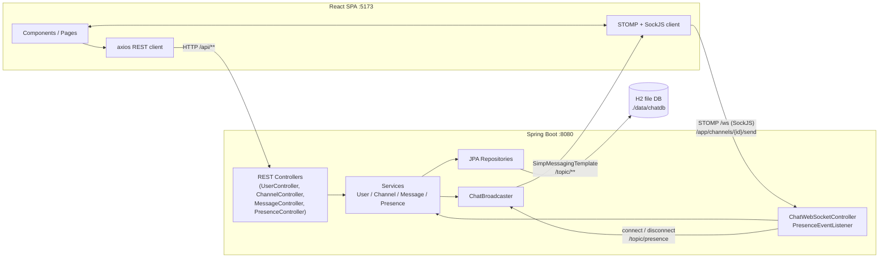
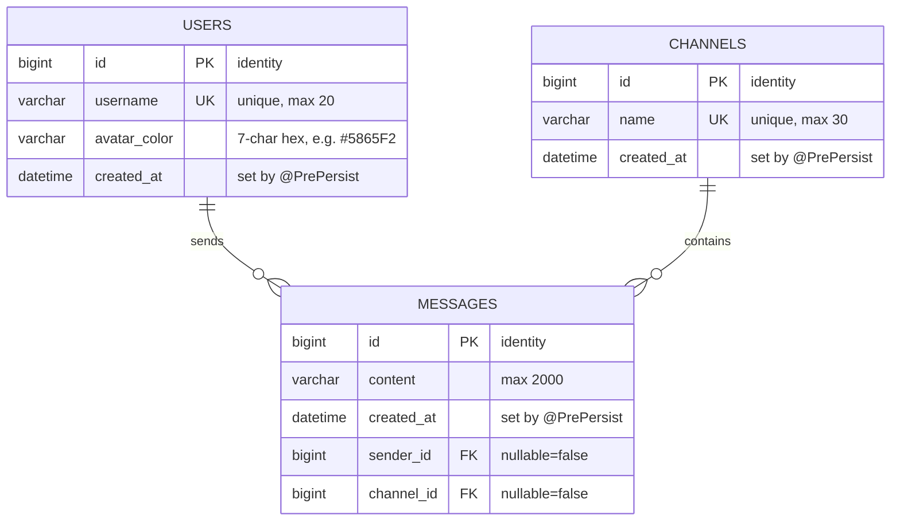

# REPORT_INFO — Real-Time Chat Application

All facts in this document were taken from the actual source code in `backend/` and `frontend/`.

---

## 1. PROJECT OVERVIEW

**Project name:** ChatApp — a Discord-inspired real-time group chat web application.

**Description:** ChatApp is a full-stack, channel-based chat application. Users pick a username and an avatar color to "log in" (no password), join shared channels such as `#general`, and exchange messages that appear instantly on every connected user's screen through WebSockets. The application also shows who is online, who is currently typing, and lets users create or delete channels on the fly. The backend is built with Spring Boot (Java 17) and exposes both a REST API for data loading and a STOMP-over-WebSocket layer for live updates; the frontend is a React 18 single-page application styled with Tailwind CSS to resemble a modern chat client. Data is stored in an embedded H2 file database so it survives restarts with zero setup.

**Problem it solves:** Traditional web pages require refreshing to see new data. ChatApp demonstrates how WebSockets remove that limitation: when one user sends a message, every other user viewing the same channel receives it in milliseconds without any page reload.

**Users:** Anyone who wants a lightweight, self-hosted group chat — classmates, small teams, or a college demo. In this project anyone with a unique username can join; there are no accounts or passwords.

---

## 2. TECH STACK

Versions are taken exactly from `backend/pom.xml` and `frontend/package.json` (runtime-resolved versions shown where the manifest declares a range).

### Backend

| Technology | Version | Why it is used in this project |
|---|---|---|
| Java | 17 (compiler target in `pom.xml`) | Language level for all backend code |
| Spring Boot (parent) | 3.5.16 | Provides embedded Tomcat, auto-configuration, and dependency management |
| spring-boot-starter-web | (managed by 3.5.16) | REST controllers and HTTP layer |
| spring-boot-starter-websocket | (managed by 3.5.16) | STOMP-over-WebSocket broker and `@MessageMapping` endpoints |
| spring-boot-starter-data-jpa | (managed by 3.5.16) | JPA repositories, entity mapping, Hibernate ORM |
| spring-boot-starter-validation | (managed by 3.5.16) | Bean Validation (`@NotBlank`, `@Pattern`, …) on request DTOs |
| Lombok | 1.18.46 (managed) | `@Getter`, `@Builder`, `@RequiredArgsConstructor` to remove boilerplate |
| spring-boot-starter-test | (managed by 3.5.16) | JUnit 5, Mockito, MockMvc for unit and slice tests |

### Frontend

| Technology | Version (installed) | Why it is used in this project |
|---|---|---|
| React | 18.3.1 | UI library for all pages and components |
| react-dom | 18.3.1 | Renders the React tree into the browser DOM |
| react-router-dom | 6.30.6 | Client-side routing (`/login`, `/chat`) with a protected route |
| axios | 1.20.0 | HTTP client for all REST calls (`frontend/src/api/client.js`) |
| @stomp/stompjs | 7.5.0 | STOMP client protocol over the SockJS transport |
| sockjs-client | 1.6.1 | WebSocket transport fallback used by the STOMP client |
| Vite | 5.4.21 | Dev server (port 5173) and production build tool |
| @vitejs/plugin-react | 4.7.0 | React fast refresh and JSX transform for Vite |
| Tailwind CSS | 4.3.3 | Utility-first styling for the entire Discord-like UI |
| @tailwindcss/vite | 4.3.3 | Tailwind's Vite build plugin |

### Database

| Technology | Version | Why it is used in this project |
|---|---|---|
| H2 (file mode) | 2.3.232 (runtime-resolved; declared in `pom.xml`) | Embedded relational database — zero-install, data persists in `backend/data/chatdb` |
| Hibernate ORM | 6.6.53.Final (via Spring Boot parent) | JPA implementation that maps the three entities to H2 tables |

A commented-out MySQL configuration block exists in `backend/src/main/resources/application.properties` (lines 17–22) to switch databases by editing properties only.

### Build tools and testing

| Technology | Version | Role |
|---|---|---|
| Apache Maven | Wrapper-less; project built with Maven 3.9.x (`mvn test`) | Builds the backend and runs backend tests |
| npm | Ships with Node.js | Installs frontend dependencies and runs `vite` |
| Playwright | 1.64.1 (dev dependency in `package.json`) | Drives real browsers for the end-to-end smoke and two-browser tests (`frontend/smoke.mjs`, `frontend/e2e.mjs`) |
| JUnit Jupiter | 5.12.2 (managed) | Backend unit/slice test framework (20 tests) |
| Mockito | 5.17.0 (managed) | Mocks repositories and services in backend tests |

---

## 3. FEATURES

1. **Password-less login with username and avatar color** — The user types a username (3–20 characters) and picks one of eight color swatches; the backend creates the user on first sight or returns the existing one. Implemented in `frontend/src/pages/LoginPage.jsx` and `backend/.../service/UserService.login()`.

2. **Channel-based public chat** — Messages belong to named channels (`#general`, `#random`, …). The channel list loads over REST and updates live. Implemented in `backend/.../service/ChannelService.java` and `frontend/src/pages/ChatPage.jsx`.

3. **Real-time message delivery** — New messages are persisted via a STOMP `@MessageMapping` and broadcast to `/topic/channels/{id}`, so every subscribed browser appends them instantly. Implemented in `backend/.../websocket/ChatWebSocketController.java`, `MessageService.saveMessage()`, `ChatBroadcaster`, and `frontend/src/hooks/useWebSocket.js`.

4. **Message history** — Opening a channel loads the latest 50 messages oldest-first via REST (`MessageService.HISTORY_LIMIT = 50`). Implemented in `backend/.../service/MessageService.getLatestMessages()` and fetched by `getMessages()` in `frontend/src/api/chatApi.js`.

5. **Delete own messages in real time** — Only the message author sees a delete button; the deletion is broadcast on `/topic/channels/{id}/events` so every client removes it. Implemented in `MessageService.deleteMessage()`, `MessageController` (`DELETE /api/messages/{id}`), and `ChatPage.handleDeleteMessage()`.

6. **Typing indicators** — While typing, the client throttles and publishes to `/app/channels/{id}/typing`; other clients show "X is typing…" with a bouncing-dot animation that clears after 3 seconds of silence or when the message arrives. Implemented in `frontend/src/components/MessageInput.jsx`, `ChatPage.handleTypingKeystroke()/handleTyping()`, `TypingIndicator.jsx`, and `ChatWebSocketController.typing()`.

7. **Online presence list** — A STOMP CONNECT header carries the username; the backend tracks sessions and broadcasts the deduplicated online list to `/topic/presence` on connect, disconnect, and every presence subscribe. An initial list is also available via `GET /api/presence`. Implemented in `backend/.../websocket/PresenceEventListener.java`, `PresenceService.java`, and `OnlineUsers.jsx`.

8. **Create channel** — The "+" button opens a modal; names are lowercased and validated (`^[a-z0-9][a-z0-9-]*$`, 2–30 chars); creation broadcasts `CHANNEL_CREATED` on `/topic/channels`. Implemented in `CreateChannelModal.jsx`, `ChannelService.create()`, and `ChatPage.handleChannelEvent()`.

9. **Delete channel (with all messages)** — Sidebar hover shows an "✕" per channel (keyboard accessible); confirmation is required; messages are deleted first, then the channel, and `CHANNEL_DELETED` is broadcast so open clients switch away. Implemented in `ChannelSidebar.jsx`, `ChatPage.handleChannelDelete()`, and `ChannelService.delete()`.

10. **Message grouping and timestamps** — Consecutive messages from the same sender within 5 minutes collapse into a group (avatar and name shown once); timestamps show time-of-day for today, full date otherwise. Implemented in `frontend/src/components/MessageList.jsx` (GROUP_WINDOW_MS) and `MessageItem.jsx`.

11. **Global error toasts** — Every failed REST call surfaces the backend's JSON `message` via a toast that auto-dismisses after 4 seconds. Implemented in `frontend/src/context/ToastContext.jsx` and `extractErrorMessage()` in `frontend/src/api/client.js`.

12. **Responsive three-column layout** — Channel sidebar (left), chat area (center), online users (right, hidden below `lg` breakpoint); dark Discord-style theme. Implemented in `ChatPage.jsx`, `ChannelSidebar.jsx`, `OnlineUsers.jsx`, and `frontend/src/index.css`.

13. **Seed data on first run** — An empty database is populated with `#general`, `#random`, `#tech-talk`, a "System" user, and four welcome messages. Implemented in `backend/.../config/DataSeeder.java`.

---

## 4. SYSTEM ARCHITECTURE

The application follows a classic three-tier architecture with an additional real-time push layer:

- **Client (React SPA)** — holds all UI state, loads data over HTTP, and keeps one long-lived STOMP connection for live events.
- **REST layer** — Spring `@RestController` classes handle login, channel CRUD, message history, message deletion, and the initial presence snapshot.
- **WebSocket/STOMP layer** — `WebSocketConfig` registers the `/ws` SockJS endpoint with a simple `/topic` broker and `/app` application prefix; `ChatWebSocketController` receives client sends; `ChatBroadcaster` is the single place that knows topic names; `PresenceEventListener` reacts to connect/disconnect/subscribe lifecycle events.
- **Service layer** — `UserService`, `ChannelService`, `MessageService`, and `PresenceService` contain all business rules (validation, ownership checks, normalization, broadcasting).
- **Repository layer** — three Spring Data `JpaRepository` interfaces (with one custom JPQL `JOIN FETCH` query each where needed).
- **Database** — embedded H2 in file mode (`jdbc:h2:file:./data/chatdb`).



### REST request flow (example: load channels)

1. `ChatPage.jsx` mounts and calls `getChannels()` from `frontend/src/api/chatApi.js`.
2. `client.js` (axios, `baseURL: http://localhost:8080/api`) sends `GET /api/channels`.
3. `CorsConfig` allows the origin `http://localhost:5173`.
4. `ChannelController.getAll()` calls `ChannelService.getAll()`.
5. `ChannelService` loads all channels, sorts them case-insensitively by name, maps each to `ChannelResponse` (including `messageRepository.countByChannelId` for the message count).
6. The JSON array is returned; `ChatPage` stores it in `channels` state and selects the first channel.

### Real-time message flow (example: send a message)

1. User types in `MessageInput.jsx`; Enter (without Shift) calls `submit()` → `ChatPage.handleSend(content)`.
2. `handleSend` calls `sendMessage(channelId, content, user.id)` from the `useWebSocket` hook.
3. The hook publishes `{content, senderId}` to destination `/app/channels/{channelId}/send` over the open STOMP connection (`/ws` SockJS endpoint).
4. Spring routes the frame to `ChatWebSocketController.sendMessage()` via `@MessageMapping("/channels/{channelId}/send")`.
5. The controller calls `MessageService.saveMessage()`, which trims/validates content (max 2000 chars), loads channel and sender, saves the `Message` entity, and builds a `MessageResponse`.
6. `MessageService` calls `ChatBroadcaster.broadcastMessage(response)`, which uses `SimpMessagingTemplate.convertAndSend("/topic/channels/{id}", message)`.
7. Every browser subscribed to `/topic/channels/{id}` receives the payload; `useWebSocket`'s subscription callback invokes `onMessage` → `ChatPage.handleLiveMessage()`, which deduplicates by message id (guarded by `messageIdsRef`) and appends to `messages` state.
8. `MessageList` re-renders and auto-scrolls to the new bottom anchor.

---

## 5. BACKEND DETAILS

Root package: `com.example.chatapp` (`backend/src/main/java/com/example/chatapp/`).

### Package structure

| Package / class | One-line description |
|---|---|
| `ChatAppApplication` | Spring Boot entry point (`@SpringBootApplication`) |
| `config.CorsConfig` | Allows REST calls from the Vite dev origin on `/api/**` |
| `config.DataSeeder` | `CommandLineRunner` that seeds channels/messages only when the DB is empty |
| `config.WebSocketConfig` | Registers the `/ws` SockJS STOMP endpoint, `/topic` broker, `/app` prefix |
| `controller.UserController` | `POST /api/users/login` |
| `controller.ChannelController` | `GET/POST/DELETE /api/channels` |
| `controller.MessageController` | `GET /api/channels/{channelId}/messages`, `DELETE /api/messages/{id}` |
| `controller.PresenceController` | `GET /api/presence` |
| `dto.LoginRequest` | Login payload with validation (`@NotBlank`, `@Size`, `@Pattern`) |
| `dto.UserResponse` | `{id, username, avatarColor}` returned to clients |
| `dto.ChannelRequest` | Channel-creation payload with name validation |
| `dto.ChannelResponse` | `{id, name, createdAt, messageCount}` |
| `dto.ChannelEventResponse` | `{type: CHANNEL_CREATED\|CHANNEL_DELETED, channel}` broadcast on `/topic/channels` |
| `dto.MessageResponse` | Flattened message with sender fields |
| `dto.MessageDeletedResponse` | `{messageId, channelId, deletedBy}` |
| `dto.SendMessagePayload` | STOMP send payload `{senderId, content}` |
| `dto.TypingPayload` | STOMP typing payload `{username}` |
| `dto.TypingResponse` | Broadcast typing state `{channelId, username, typing}` |
| `dto.PresenceResponse` | Wrapper `{onlineUsers: [...]}` |
| `dto.ErrorResponse` | Standard error body `{timestamp, status, error, message, path, fieldErrors}` |
| `entity.User` | JPA entity mapped to table `users` |
| `entity.Channel` | JPA entity mapped to table `channels` |
| `entity.Message` | JPA entity mapped to table `messages` |
| `exception.NotFoundException` | 404 for missing users/channels/messages |
| `exception.ConflictException` | 409 for duplicate channel names |
| `exception.ForbiddenActionException` | 403 when deleting a message you do not own |
| `exception.GlobalExceptionHandler` | `@RestControllerAdvice` translating exceptions to `ErrorResponse` |
| `repository.UserRepository` | `findByUsername`, `existsByUsername` |
| `repository.ChannelRepository` | `existsByName` |
| `repository.MessageRepository` | Custom JPQL `JOIN FETCH` queries, `countByChannelId`, `deleteByChannelId` |
| `service.UserService` | Login (find-or-create), `getById`, `getByUsername` |
| `service.ChannelService` | List/create/delete channels, broadcasts channel events |
| `service.MessageService` | History, save+broadcast, delete+broadcast with ownership check |
| `service.PresenceService` | Session map, online list (deduplicated per user), broadcasts |
| `websocket.ChatWebSocketController` | `@MessageMapping` for send and typing |
| `websocket.ChatBroadcaster` | Single owner of all `/topic` destination names; `SimpMessagingTemplate` calls |
| `websocket.PresenceEventListener` | `@EventListener` for `SessionConnectEvent`, `SessionDisconnectEvent`, `SessionSubscribeEvent` |

### Layered architecture in action

Controller → Service → Repository, with broadcasting living in the service (which calls `ChatBroadcaster`):

- **Example (create channel):** `ChannelController.create(@Valid ChannelRequest)` → `ChannelService.create()` normalizes the name (trim + lowercase), rejects duplicates via `ChannelRepository.existsByName`, saves via `channelRepository.save`, then `ChatBroadcaster.broadcastChannelEvent(...)`.
- **Example (delete message):** `MessageController.deleteMessage(id, userId)` → `MessageService.deleteMessage()` loads with `MessageRepository.findByIdWithSender`, throws `ForbiddenActionException` unless `message.getSender().getId().equals(userId)`, deletes, and broadcasts `MessageDeletedResponse`.
- Controllers never touch repositories directly; repositories never broadcast.

### Spring concepts used (with file evidence)

| Concept | Where it appears |
|---|---|
| Dependency injection (constructor, via Lombok) | `@RequiredArgsConstructor` on all services/controllers (`ChannelService.java`, `UserController.java`, …) |
| `@RestController` + `@RequestMapping`/`@GetMapping`/`@PostMapping`/`@DeleteMapping` | `controller/*.java` |
| Bean Validation (`@Valid`, `@NotBlank`, `@Size`, `@Pattern`, `@NotNull`) | `UserController`, `ChannelController`, `LoginRequest`, `ChannelRequest`, `SendMessagePayload` |
| `@RestControllerAdvice` + `@ExceptionHandler` | `exception/GlobalExceptionHandler.java` (404, 409, 403, 400, 500, validation, malformed body, type mismatch) |
| Spring Data JPA repositories | `repository/*.java` (`JpaRepository`, `@Query`, `@Modifying`, `@Param`) |
| JPA entity mapping (`@Entity`, `@Table`, `@ManyToOne`, `@JoinColumn`, `@PrePersist`, `FetchType.LAZY`) | `entity/User.java`, `entity/Channel.java`, `entity/Message.java` |
| `@Transactional` | `ChannelService.delete`, `MessageService.deleteMessage` |
| WebSocket broker config (`@EnableWebSocketMessageBroker`, `StompEndpointRegistry`, `MessageBrokerRegistry`) | `config/WebSocketConfig.java` |
| `@Controller` + `@MessageMapping` / `@DestinationVariable` | `websocket/ChatWebSocketController.java` |
| `SimpMessagingTemplate` broadcasts | `websocket/ChatBroadcaster.java` |
| Spring event listeners (`SessionConnectEvent`, `SessionDisconnectEvent`, `SessionSubscribeEvent`) | `websocket/PresenceEventListener.java` |
| CORS (`WebMvcConfigurer.addCorsMappings`) | `config/CorsConfig.java` |
| `CommandLineRunner` seeding | `config/DataSeeder.java` |
| Configuration properties | `src/main/resources/application.properties` (`spring.jpa.open-in-view=false`, H2 console, datasource URL) |
| Lombok | Entities, DTOs, services, controllers (`@Getter`, `@Setter`, `@Builder`, `@Slf4j`) |

---

## 6. DATABASE DESIGN

**Database:** H2 2.3.232 in file mode — `spring.datasource.url=jdbc:h2:file:./data/chatdb`, user `sa`, no password, `ddl-auto=update` (Hibernate creates/updates tables). The H2 web console is enabled at `http://localhost:8080/h2-console`. A commented MySQL block sits below in the same properties file for swapping engines without code changes.

Three tables exist (created from three entities): `users`, `channels`, `messages`. Relationships: one user sends many messages; one channel contains many messages. There is no membership/role table — all channels are public and every logged-in user can post anywhere.

### Mermaid ER diagram



### Table: `users` (entity `User.java`)

| Column | Type | Constraints | Description |
|---|---|---|---|
| `id` | BIGINT | PK, identity | Primary key |
| `username` | VARCHAR(20) | NOT NULL, UNIQUE | Display name, 3–20 chars (validated in `LoginRequest`) |
| `avatar_color` | VARCHAR(7) | NOT NULL | Hex color string like `#5865F2`; default applied in `UserService.normalizeColor` |
| `created_at` | DATETIME | NOT NULL | Timestamp; set by `@PrePersist onCreate()` if null |

### Table: `channels` (entity `Channel.java`)

| Column | Type | Constraints | Description |
|---|---|---|---|
| `id` | BIGINT | PK, identity | Primary key |
| `name` | VARCHAR(30) | NOT NULL, UNIQUE | Lowercase channel name without `#`; normalized in `ChannelService.create` |
| `created_at` | DATETIME | NOT NULL | Timestamp; set by `@PrePersist onCreate()` if null |

### Table: `messages` (entity `Message.java`)

| Column | Type | Constraints | Description |
|---|---|---|---|
| `id` | BIGINT | PK, identity | Primary key |
| `content` | VARCHAR(2000) | NOT NULL | Message text; trimmed and length-checked in `MessageService.saveMessage` |
| `created_at` | DATETIME | NOT NULL | Timestamp; set by `@PrePersist onCreate()` if null |
| `sender_id` | BIGINT | FK → `users.id`, NOT NULL, `@ManyToOne(LAZY)` | Message author |
| `channel_id` | BIGINT | FK → `channels.id`, NOT NULL, `@ManyToOne(LAZY)` | Channel the message belongs to |

---

## 7. API DOCUMENTATION

Base URL: `http://localhost:8080`. All REST paths are under `/api`. Errors return `ErrorResponse`: `{timestamp, status, error, message, path, fieldErrors?}`.

### REST endpoints

| Method | URL | Request body | Response | Description | Status codes |
|---|---|---|---|---|---|
| POST | `/api/users/login` | `{"username": string, "avatarColor"?: string}` | `UserResponse` | Find-or-create user by username | 200; 400 (validation) |
| GET | `/api/channels` | — | `ChannelResponse[]` | All channels, sorted by name, each with `messageCount` | 200 |
| POST | `/api/channels` | `{"name": string}` | `ChannelResponse` | Create channel (lowercased); broadcasts `CHANNEL_CREATED` | 201; 400 (validation); 409 (duplicate name) |
| DELETE | `/api/channels/{id}` | — | empty | Delete channel and all its messages; broadcasts `CHANNEL_DELETED` | 204; 404 |
| GET | `/api/channels/{channelId}/messages` | — | `MessageResponse[]` | Latest 50 messages, oldest first | 200; 404 |
| DELETE | `/api/messages/{id}?userId={userId}` | — | `MessageResponse` of deleted msg | Delete own message (ownership enforced) | 200; 400 (bad param); 403 (not owner); 404 |
| GET | `/api/presence` | — | `UserResponse[]` | Current online users (initial snapshot; live updates via WS) | 200 |

### WebSocket destinations

Transport: SockJS endpoint `http://localhost:8080/ws`; STOMP CONNECT carries header `username: <name>`. Application prefix `/app`; broker prefix `/topic`.

| Destination | Direction | Payload | Description |
|---|---|---|---|
| `/app/channels/{channelId}/send` | client → server | `{"content": string, "senderId": number}` | Persist and broadcast a message |
| `/app/channels/{channelId}/typing` | client → server | `{"username": string}` | Announce typing |
| `/topic/channels/{channelId}` | server → client | `MessageResponse` | New message in channel |
| `/topic/channels/{channelId}/events` | server → client | `MessageDeletedResponse` | Message deleted from channel |
| `/topic/channels/{channelId}/typing` | server → client | `TypingResponse` | Typing state for channel |
| `/topic/channels` | server → client | `ChannelEventResponse` (`CHANNEL_CREATED` / `CHANNEL_DELETED`) | Channel list changes |
| `/topic/presence` | server → client | `PresenceResponse` `{onlineUsers: UserResponse[]}` | Full online list (re-sent on every presence subscribe) |

### Example request/response per endpoint

**POST /api/users/login**

```json
// request
{ "username": "alex", "avatarColor": "#5865F2" }
// 200 response
{ "id": 1, "username": "alex", "avatarColor": "#5865F2" }
// 400 response (blank username)
{
  "timestamp": "2026-10-23T10:00:00",
  "status": 400,
  "error": "Bad Request",
  "message": "Username is required",
  "path": "/api/users/login",
  "fieldErrors": { "username": "Username is required" }
}
```

**GET /api/channels** — 200

```json
[
  { "id": 1, "name": "general", "createdAt": "2026-10-23T09:00:00", "messageCount": 12 },
  { "id": 2, "name": "random", "createdAt": "2026-10-23T09:00:00", "messageCount": 3 }
]
```

**POST /api/channels** — request `{ "name": "music" }` → 201 `{ "id": 5, "name": "music", "createdAt": "…", "messageCount": 0 }`; duplicate → 409 `{ "message": "Channel #music already exists", ... }`.

**DELETE /api/channels/5** — 204 (no body); unknown id → 404.

**GET /api/channels/1/messages** — 200 (oldest first)

```json
[
  {
    "id": 101,
    "content": "Welcome to ChatApp! This is #general - say hi to everyone.",
    "createdAt": "2026-10-23T09:00:01",
    "channelId": 1,
    "senderId": 1,
    "senderName": "System",
    "senderAvatarColor": "#5865F2"
  }
]
```

**DELETE /api/messages/101?userId=1** — 200 returns the deleted message JSON; another user (`userId=2`) → 403 `{ "message": "You can only delete your own messages", ... }`.

**GET /api/presence** — 200 `[ { "id": 1, "username": "alex", "avatarColor": "#5865F2" } ]`

**WebSocket examples**

```json
// client -> /app/channels/1/send
{ "content": "hello", "senderId": 1 }

// server -> /topic/channels/1
{ "id": 102, "content": "hello", "createdAt": "2026-10-23T10:05:00", "channelId": 1, "senderId": 1, "senderName": "alex", "senderAvatarColor": "#5865F2" }

// server -> /topic/channels/1/events
{ "messageId": 102, "channelId": 1, "deletedBy": 1 }

// client -> /app/channels/1/typing ; server -> /topic/channels/1/typing
{ "channelId": 1, "username": "alex", "typing": true }

// server -> /topic/channels
{ "type": "CHANNEL_CREATED", "channel": { "id": 5, "name": "music", "createdAt": "…", "messageCount": 0 } }

// server -> /topic/presence
{ "onlineUsers": [ { "id": 1, "username": "alex", "avatarColor": "#5865F2" } ] }
```

---

## 8. FRONTEND DETAILS

### Folder structure (`frontend/src/`)

| File / folder | Description |
|---|---|
| `main.jsx` | ReactDOM root; mounts `<App/>` in `BrowserRouter` + `StrictMode` |
| `App.jsx` | Providers (`AuthProvider`, `ToastProvider`) and routes |
| `index.css` | Tailwind import, global dark theme, scrollbars, keyframes |
| `api/client.js` | Shared axios instance (`baseURL: http://localhost:8080/api`) + `extractErrorMessage` |
| `api/chatApi.js` | Seven typed API functions (login, channels CRUD, messages, presence) |
| `context/AuthContext.jsx` | `user` in state, persisted to `localStorage` key `chatapp.user` |
| `context/ToastContext.jsx` | Toast queue with 4 s auto-dismiss and manual close |
| `hooks/useWebSocket.js` | The single STOMP/SockJS connection for the whole app |
| `pages/LoginPage.jsx` | Login form (username + 8 color swatches) |
| `pages/ChatPage.jsx` | Main chat screen; owns channels/messages/typing/online state |
| `components/*.jsx` | 13 presentational components (listed below) |

### Pages

| Page | Route | Role |
|---|---|---|
| `LoginPage` | `/login` | State: `username`, `color`, `submitting`. Calls `login()`, stores user, navigates to `/chat`. Redirects to `/chat` if already logged in. |
| `ChatPage` | `/chat` (protected) | State: `channels`, `channelsLoading`, `activeChannelId`, `showCreateModal`, `messages`, `messagesLoading`, `countDelta`, `onlineUsers`, `typingNames`. Refs: `requestSeqRef`, `activeChannelRef`, `channelsRef`, `typingTimersRef`, `lastTypingSentRef`, `messageIdsRef`. |

### Components (props / notable state)

| Component | Props | Does |
|---|---|---|
| `Avatar` | `name, color, size('sm'\|'md'\|'lg')` | Colored circle with the first letter |
| `ChannelSidebar` | `channels, activeChannelId, onSelectChannel, onCreateClick, onDeleteChannel, loading, user, onLogout` | Left rail: channel list, "+" button, per-channel delete "✕" (keyboard accessible), user footer with logout |
| `ChannelHeader` | `channel, messageCount, connected` | Channel name, message count, green/amber connection dot |
| `MessageList` | `messages, loading, channel, currentUserId, onDelete` | Auto-scrolls to bottom; groups same-sender messages < 5 min apart; loading/empty states |
| `MessageItem` | `message, own, grouped, onDelete` | One message row; delete button only when `own` |
| `MessageInput` | `channel, disabled, onSend, onTyping` | Auto-growing textarea (max 160 px), Enter sends, Shift+Enter newline, 2000-char cap, typing callback |
| `TypingIndicator` | `usernames` | Animated dots + "X is typing…"; empty spacer when none |
| `OnlineUsers` | `users, currentUserId` | Right rail (hidden below `lg`), green presence dot, "you" badge |
| `CreateChannelModal` | `onClose, onCreated` | Name input with live regex validation, submitting state, toast on error |
| `Modal` | `title, onClose, children` | Backdrop overlay; closes on Escape and outside click |
| `ProtectedRoute` | `children` | Redirects to `/login` when no user |
| `EmptyState` | `icon, title, subtitle` | Centered empty-channel / no-selection screen |
| `Spinner` | `label` | Animated loading indicator |

### State management

- No Redux/Zustand — plain React state plus two Contexts:
  - **`AuthContext`** — `user` object `{id, username, avatarColor}` persisted in `localStorage` (`chatapp.user`); `setUser(null)` logs out.
  - **`ToastContext`** — `showToast(message, type='error')` appends toasts that dismiss after 4000 ms; rendered in a fixed bottom-right stack.
- **Custom hook `useWebSocket`** — one STOMP client per logged-in user. SockJS and stompjs are dynamically imported (`import('sockjs-client')`) to keep them out of the initial bundle. `connectHeaders: {username}` identifies the user to the broker. Auto-reconnect every 4 s (`reconnectDelay: 4000`), heartbeats every 10 s. Handlers are stored in `handlersRef` so callbacks changing each render never rebuild the connection. `applySubscriptions()` unsubscribes all previous subscriptions before re-subscribing (prevents duplicate handlers), then subscribes to `/topic/presence`, `/topic/channels`, and — when a channel is active — the three per-channel topics. Cleanup on unmount/user change deactivates the client and unsubscribes everything. `sendMessage`/`sendTyping` publish to `/app/...` destinations.

### Routing

`main.jsx` wraps the app in `BrowserRouter`. `App.jsx` defines:

- `/login` → `LoginPage`
- `/chat` → `ProtectedRoute` → `ChatPage` (redirects to `/login` when `user` is null)
- `*` → `Navigate to="/login" replace`

### WebSocket lifecycle summary

1. User logs in → `ChatPage` mounts → `useWebSocket` effect runs (depends on `user?.username`).
2. Dynamic imports resolve; `Client` connects to `http://localhost:8080/ws` (SockJS) with the username header.
3. `onConnect` sets `connected=true` and calls `applySubscriptions()`.
4. Switching channels triggers the subscription effect (unsubscribe-all → re-subscribe with the new channel's topics).
5. Disconnect/error sets `connected=false`; the STOMP client auto-reconnects after 4 s and `onConnect` re-subscribes.
6. Unmount (logout or page change) deactivates the client and clears all subscriptions.

### UI/UX highlights

- Discord-inspired dark palette (`#313338` chat, `#2b2d31` sidebars, blurple `#5865F2` accents).
- Three-column responsive layout; online list collapses below the `lg` breakpoint.
- Connection status dot in the header flips green ("Connected") / amber pulsing ("Connecting…").
- Custom thin scrollbars and `toast-in` / `modal-in` / `message-in` keyframe animations in `index.css`.
- Destructive actions confirm first (`window.confirm` for channel delete); toasts explain failures.
- Keyboard support: Enter/Shift+Enter in the composer, Escape/backdrop close on modals, Enter on the sidebar delete control.
- Loading (`Spinner`) and empty (`EmptyState`) states for channels and messages.

---

## 9. KEY WORKFLOWS

### User login

1. `LoginPage.handleSubmit` trims the username and blocks submit under 3 characters.
2. `login(name, color)` (`frontend/src/api/chatApi.js`) POSTs `/api/users/login`.
3. `UserController.login` → `UserService.login`: finds by username or creates with the chosen color (`normalizeColor` falls back to `#5865F2`).
4. Response `UserResponse` is stored via `AuthContext.setUser` (persisted to `localStorage`) and the router navigates to `/chat`.
5. `ProtectedRoute` allows `ChatPage` because `user` is now set. Validation failures (400/409) surface as toasts via `extractErrorMessage`.

### Loading channels and message history

1. `ChatPage` mount effect: `getChannels()` → `GET /api/channels` → `ChannelService.getAll()` (sorted, with counts). First channel is auto-selected if none chosen yet.
2. Mount effect also calls `getOnlineUsers()` → `GET /api/presence` for the initial sidebar list (WS presence updates refine it).
3. A second effect keyed on `activeChannelId` resets typing state, increments `requestSeqRef` (guards against out-of-order responses), clears `messages`, and calls `getMessages(id)` → `GET /api/channels/{id}/messages` → `MessageService.getLatestMessages` (latest 50, reversed to oldest-first).
4. History is merged with any live extras already received (`liveExtras` filter by channel and non-duplicate ids).
5. `MessageList` shows a spinner while loading, an empty state if history is empty, otherwise the grouped list with auto-scroll.

### Sending a message in real time

1. `MessageInput.submit` trims the text, ignores empty/disabled, calls `onSend(content)`, clears the textarea, resets its height.
2. `ChatPage.handleSend` calls `useWebSocket.sendMessage(activeChannelRef.current, content, user.id)`; if the client is not connected it toasts and aborts. It also resets `lastTypingSentRef` so the next typing burst is immediate.
3. The hook publishes JSON to `/app/channels/{id}/send`.
4. `ChatWebSocketController.sendMessage` (annotated `@MessageMapping("/channels/{channelId}/send")`) calls `MessageService.saveMessage`.
5. `MessageService.saveMessage` trims, validates non-empty and ≤2000 chars, loads channel + sender, saves, and broadcasts via `ChatBroadcaster.broadcastMessage` to `/topic/channels/{id}`.
6. Every client's `useWebSocket` subscription fires `onMessage` → `ChatPage.handleLiveMessage`: clears the sender's typing timer, ignores other channels, deduplicates by id (`messageIdsRef` + state check), appends, and bumps `countDelta` (used to update the header count without refetching).

### Deleting a message in real time

1. `MessageItem` shows the delete button only for `own` messages; `ChatPage.handleDeleteMessage` is invoked on click.
2. `deleteMessage(message.id, user.id)` calls `DELETE /api/messages/{id}?userId={userId}` and locally removes the message on success.
3. `MessageController.deleteMessage` → `MessageService.deleteMessage` (`@Transactional`): loads with `findByIdWithSender`, throws `ForbiddenActionException` (403) for non-owners, deletes, broadcasts `MessageDeletedResponse` on `/topic/channels/{id}/events`.
4. Remote clients receive `handleMessageDeleted`, which decrements `countDelta` for the active channel and filters the message out of `messages`.

### Typing indicator

1. `MessageInput.handleChange` calls `onTyping()` whenever non-empty text changes.
2. `ChatPage.handleTypingKeystroke` throttles to one send per 2000 ms (`TYPING_THROTTLE_MS`) using `lastTypingSentRef`, then `sendTyping(channelId, username)` publishes to `/app/channels/{id}/typing`.
3. `ChatWebSocketController.typing` immediately re-broadcasts `TypingResponse{channelId, username, typing:true}` on `/topic/channels/{id}/typing`.
4. `ChatPage.handleTyping` ignores the payload for other channels and for the current user; for each username it (re)starts a 3000 ms linger timer (`TYPING_LINGER_MS`) and refreshes `typingNames`.
5. `TypingIndicator` renders "X is typing…" / "X and Y…" / "Several people are typing…" with animated dots. Sending a message or receiving one from that sender clears their timer immediately.

### Online presence tracking

1. On STOMP CONNECT the client sends header `username`; `PresenceEventListener.handleSessionConnect` (`SessionConnectEvent` — chosen because the CONNECT frame carries the custom header) extracts it from native headers, loads the user, and calls `PresenceService.userConnected(sessionId, user)`.
2. `PresenceService` stores `sessionId → user` in a `ConcurrentHashMap` and broadcasts the deduplicated list (one entry per user id) on `/topic/presence`.
3. `handleSessionDisconnect` removes the session and re-broadcasts only if that session existed.
4. `handleSubscribe` re-broadcasts whenever any client subscribes to `/topic/presence`, so a fresh subscriber always receives the current list immediately (closes the connect/subscribe race).
5. Clients also fetch `GET /api/presence` on page load for the first paint; `handlePresence` replaces `onlineUsers` state wholesale.
6. `OnlineUsers` renders the list with green presence dots and a "you" badge.

### Creating a channel

1. Sidebar "+" opens `CreateChannelModal`; input is lowercased live; submit is enabled only for valid names (2–30 chars, `^[a-z0-9][a-z0-9-]*$`) and not while submitting.
2. `createChannel(normalized)` POSTs `/api/channels`; on success `onCreated(channel)` appends it (id-deduplicated), selects it, and closes the modal; errors toast.
3. `ChannelController.create` → `ChannelService.create` (normalizes again, 409 on `existsByName`) → `ChatBroadcaster.broadcastChannelEvent(CHANNEL_CREATED)` on `/topic/channels`.
4. Other clients' `handleChannelEvent` appends the new channel if it is not already present.

### Deleting a channel

1. `ChannelSidebar` delete "✕" (hidden until hover, keyboard Enter supported) calls `onDeleteChannel`; `ChatPage.handleChannelDelete` asks `window.confirm("Delete #name and all of its messages?")`.
2. `deleteChannel(id)` → `DELETE /api/channels/{id}`; the channel is removed locally and the active channel falls back to the first remaining one (or null).
3. `ChannelService.delete` (`@Transactional`) loads the channel, `messageRepository.deleteByChannelId` first, then deletes the channel, then broadcasts `CHANNEL_DELETED`.
4. Remote clients run the same local removal logic through `handleChannelEvent`, switching away if the deleted channel was active.

---

## 10. KEY CODE SNIPPETS

### WebSocket configuration — `backend/src/main/java/com/example/chatapp/config/WebSocketConfig.java`

```java
@Configuration
@EnableWebSocketMessageBroker
public class WebSocketConfig implements WebSocketMessageBrokerConfigurer {

    @Override
    public void registerStompEndpoints(StompEndpointRegistry registry) {
        registry.addEndpoint("/ws")
                .setAllowedOriginPatterns("http://localhost:5173")
                .withSockJS();
    }

    @Override
    public void configureMessageBroker(MessageBrokerRegistry registry) {
        registry.enableSimpleBroker("/topic");
        registry.setApplicationDestinationPrefixes("/app");
    }
}
```

### REST controller — `backend/src/main/java/com/example/chatapp/controller/ChannelController.java`

```java
@RestController
@RequestMapping("/api/channels")
@RequiredArgsConstructor
public class ChannelController {

    private final ChannelService channelService;

    @GetMapping
    public ResponseEntity<List<ChannelResponse>> getAll() {
        return ResponseEntity.ok(channelService.getAll());
    }

    @PostMapping
    public ResponseEntity<ChannelResponse> create(@Valid @RequestBody ChannelRequest request) {
        return ResponseEntity.status(HttpStatus.CREATED).body(channelService.create(request));
    }

    @DeleteMapping("/{id}")
    public ResponseEntity<Void> delete(@PathVariable Long id) {
        channelService.delete(id);
        return ResponseEntity.noContent().build();
    }
}
```

### Service method (ownership + broadcast) — `backend/src/main/java/com/example/chatapp/service/MessageService.java`

```java
@Transactional
public MessageResponse deleteMessage(Long messageId, Long userId) {
    Message message = messageRepository.findByIdWithSender(messageId)
            .orElseThrow(() -> new NotFoundException("Message not found with id " + messageId));
    if (!message.getSender().getId().equals(userId)) {
        throw new ForbiddenActionException("You can only delete your own messages");
    }
    MessageResponse response = toResponse(message);
    messageRepository.delete(message);
    broadcaster.broadcastMessageDeleted(
            new MessageDeletedResponse(response.getId(), response.getChannelId(), userId));
    return response;
}
```

### Entity — `backend/src/main/java/com/example/chatapp/entity/Message.java`

```java
@Entity
@Table(name = "messages")
@Getter @Setter @NoArgsConstructor @AllArgsConstructor @Builder
public class Message {

    @Id
    @GeneratedValue(strategy = GenerationType.IDENTITY)
    private Long id;

    @Column(nullable = false, length = 2000)
    private String content;

    @Column(name = "created_at", nullable = false)
    private LocalDateTime createdAt;

    @ManyToOne(fetch = FetchType.LAZY, optional = false)
    @JoinColumn(name = "sender_id", nullable = false)
    private User sender;

    @ManyToOne(fetch = FetchType.LAZY, optional = false)
    @JoinColumn(name = "channel_id", nullable = false)
    private Channel channel;
}
```

### Frontend WebSocket hook (subscriptions) — `frontend/src/hooks/useWebSocket.js`

```javascript
const applySubscriptions = useCallback(() => {
    const client = clientRef.current
    if (!client || !client.connected) return

    subsRef.current.forEach((subscription) => {
      try { subscription.unsubscribe() } catch { /* session may already be closed */ }
    })
    subsRef.current = []

    const parse = (raw) => { try { return JSON.parse(raw.body) } catch { return null } }

    subsRef.current.push(client.subscribe('/topic/presence', (raw) => {
      const payload = parse(raw); if (payload) handlersRef.current.onPresence?.(payload)
    }))
    subsRef.current.push(client.subscribe('/topic/channels', (raw) => {
      const payload = parse(raw); if (payload) handlersRef.current.onChannelEvent?.(payload)
    }))

    const channelId = activeChannelRef.current
    if (channelId != null) {
      subsRef.current.push(client.subscribe(`/topic/channels/${channelId}`, (raw) => {
        const payload = parse(raw); if (payload) handlersRef.current.onMessage?.(payload)
      }))
      // ... /events and /typing subscriptions follow the same pattern
    }
}, [])
```

### Message send handler — `frontend/src/pages/ChatPage.jsx`

```javascript
function handleLiveMessage(message) {
    if (message.senderId !== user.id) {
      const timers = typingTimersRef.current
      if (timers[message.senderName]) {
        clearTimeout(timers[message.senderName])
        delete timers[message.senderName]
        setTypingNames(Object.keys(timers))
      }
    }
    if (message.channelId !== activeChannelRef.current) return
    if (messageIdsRef.current.has(message.id)) return
    messageIdsRef.current.add(message.id)
    setMessages((current) =>
      current.some((existing) => existing.id === message.id) ? current : [...current, message],
    )
    setCountDelta((delta) => delta + 1)
}
```

### Publish helper — `frontend/src/hooks/useWebSocket.js`

```javascript
const sendMessage = useCallback((channelId, content, senderId) => {
    const client = clientRef.current
    if (!client?.connected || channelId == null) return false
    client.publish({
      destination: `/app/channels/${channelId}/send`,
      body: JSON.stringify({ content, senderId }),
    })
    return true
}, [])
```

---

## 11. TESTING

Command run: `mvn test` (Maven 3.9.6, JDK 17) in `backend/`.

**Real result:**

```
Tests run: 2, Failures: 0, Errors: 0, Skipped: 0 -- in com.example.chatapp.controller.UserControllerTest
Tests run: 5, Failures: 0, Errors: 0, Skipped: 0 -- in com.example.chatapp.service.ChannelServiceTest
Tests run: 6, Failures: 0, Errors: 0, Skipped: 0 -- in com.example.chatapp.service.MessageServiceTest
Tests run: 3, Failures: 0, Errors: 0, Skipped: 0 -- in com.example.chatapp.service.PresenceServiceTest
Tests run: 4, Failures: 0, Errors: 0, Skipped: 0 -- in com.example.chatapp.service.UserServiceTest

Tests run: 20, Failures: 0, Errors: 0, Skipped: 0
BUILD SUCCESS
```

**Every test, what it verifies:**

| Test class | Test | Verifies |
|---|---|---|
| `UserControllerTest` (`@WebMvcTest`) | `loginReturnsUserJson` | Valid POST `/api/users/login` returns 200 with `id/username/avatarColor` JSON |
| | `loginRejectsBlankUsername` | Blank username returns 400 with `message` and `fieldErrors.username` |
| `UserServiceTest` (Mockito) | `loginCreatesNewUserWhenUsernameIsUnknown` | Unknown username is trimmed, saved, and mapped to a response |
| | `loginReturnsExistingUserWithoutCreating` | Known username returns existing data and never saves |
| | `loginUsesDefaultColorWhenNoneProvided` | Null color falls back to `UserService.DEFAULT_AVATAR_COLOR` (`#5865F2`) |
| | `getByIdThrowsWhenUserIsMissing` | Unknown id throws `NotFoundException` mentioning the id |
| `ChannelServiceTest` (Mockito) | `createSavesNormalizedChannelName` | `" Music "` is lowercased and persisted as `music` |
| | `createRejectsDuplicateChannelName` | Existing name throws `ConflictException` |
| | `deleteRemovesChannelAndItsMessages` | Delete removes messages first, then the channel |
| | `deleteThrowsWhenChannelIsMissing` | Unknown channel id throws `NotFoundException` |
| | `getAllSortsChannelsByName` | Channels sort case-insensitively and include `messageCount` |
| `MessageServiceTest` (Mockito) | `getLatestMessagesReturnsOldestFirst` | History is reversed to chronological order |
| | `saveMessagePersistsAndMapsSender` | Content is trimmed, sender/channel mapped, id returned |
| | `saveMessageRejectsBlankContent` | Blank content throws `IllegalArgumentException`; nothing saved |
| | `deleteMessageAllowsOwner` | Owner can delete; entity removed; deleted payload returned |
| | `deleteMessageRejectsNonOwner` | Non-owner gets `ForbiddenActionException`; nothing deleted |
| | `deleteMessageThrowsWhenMissing` | Unknown message id throws `NotFoundException` |
| `PresenceServiceTest` (Mockito) | `connectAddsUserAndBroadcastsPresence` | Connecting adds the user and broadcasts a one-entry list |
| | `disconnectRemovesUser` | Disconnecting one session leaves the other user online |
| | `sameUserWithTwoSessionsAppearsOnce` | Two sessions of the same user appear once in the online list |

Backend tests are unit/slice tests with mocked repositories and broadcasters; WebSocket transport itself and the React UI are exercised separately by Playwright scripts (`frontend/smoke.mjs` — single-browser flow; `frontend/e2e.mjs` — two-browser real-time checks; `run-tests.ps1` orchestrates servers + both suites).

---

## 12. HOW TO RUN

**Prerequisites**

- JDK 17+ on `PATH`
- Maven 3.9.x (project built/tested with `mvn`; on this machine Maven lives at `$HOME\apache-maven-3.9.6\bin\mvn.cmd`)
- Node.js 18+ with npm

**Backend**

```powershell
cd backend
mvn spring-boot:run
# listens on http://localhost:8080
# H2 console: http://localhost:8080/h2-console  (JDBC URL: jdbc:h2:file:./data/chatdb, user sa, empty password)
```

**Frontend**

```powershell
cd frontend
npm install
npm run dev
# opens http://localhost:5173
```

**Ports:** backend `8080`, frontend `5173` (CORS and the SockJS endpoint both allow `http://localhost:5173`).

**Demo/seed data:** On first boot with an empty database, `DataSeeder` creates channels `#general`, `#random`, `#tech-talk`, a `System` user, and four welcome messages. The file database persists in `backend/data/`; delete that folder to re-seed.

**Optional:** switch `application.properties` to MySQL by uncommenting the MySQL block and commenting out the H2 block.

**One-shot test run (fresh DB):**

```powershell
.\run-tests.ps1
# stops old processes, wipes backend/data, starts both servers,
# runs frontend/smoke.mjs then frontend/e2e.mjs, then cleans backend/data again
```

**Build frontend for production:** `cd frontend && npm run build` (outputs `frontend/dist/`).

---

## 13. CHALLENGES AND SOLUTIONS

Each item below has visible evidence in the code.

1. **SockJS breaks in the Vite ESM build (`global is not defined`)** — `sockjs-client` expects a CommonJS-style `global`. Solved by mapping it to `window` in `frontend/vite.config.js`:

   ```javascript
   // sockjs-client expects a CommonJS-style `global`
   define: { global: 'window' },
   ```

2. **Custom STOMP CONNECT headers were missing from `SessionConnectedEvent`** — Presence tracking originally listened for `SessionConnectedEvent`, but the connected (receipt) frame does not carry the custom `username` header sent at CONNECT. Solved by listening to `SessionConnectEvent` instead, which wraps the original CONNECT frame; `PresenceEventListener.handleSessionConnect` documents this and extracts the header from `NATIVE_HEADERS` (handling the `List<String>` shape Spring produces).

3. **Race between the presence broadcast and a client's subscription** — A user who connected received the presence broadcast before their browser had subscribed to `/topic/presence`, so the sidebar could stay stale. Solved in `PresenceEventListener.handleSubscribe`: any `SessionSubscribeEvent` for `ChatBroadcaster.PRESENCE_TOPIC` triggers `presenceService.broadcastOnlineUsers()`, so every new subscriber immediately gets the current state. An initial `GET /api/presence` (added in `ChatPage`) covers first paint before the WS connects.

4. **Duplicate message delivery / duplicate subscriptions** — Channel switches and reconnects could stack multiple subscriptions to the same topic, double-appending messages. Solved in `useWebSocket.applySubscriptions()`: every previous subscription is unsubscribed before new ones are created, and handlers are read at event time from `handlersRef` (never captured stale). On the receiving side, `ChatPage.handleLiveMessage` deduplicates by message id using `messageIdsRef` (a `Set` rebuilt from state) plus a state-level `some()` check.

5. **Out-of-order REST responses when switching channels fast** — A slow history response for channel A could overwrite channel B's messages. Solved with `requestSeqRef` in `ChatPage`: each load increments the sequence and ignores responses whose id no longer matches.

6. **Lazy loading N+1 / open-session-in-view** — `Message` maps `sender` and `channel` with `FetchType.LAZY`, and `spring.jpa.open-in-view=false` is set in `application.properties`. Solved with explicit JPQL `JOIN FETCH` queries in `MessageRepository.findLatestByChannelId` and `findByIdWithSender`, so responses never hit the session outside the service transaction.

7. **Java 17 immutability — `List.reversed()` unavailable** — The history query returns newest-first; reversing with `List.reversed()` is not available on the Java level used here. Solved by collecting into a mutable `ArrayList` and calling `Collections.reverse` in `MessageService.getLatestMessages`.

8. **Friendly error messages from non-JSON failure bodies** — Some server errors arrive as plain text or as JSON that axios leaves as a string. Solved by `extractErrorMessage` in `frontend/src/api/client.js`, which handles the JSON object case, attempts `JSON.parse` on `{`-prefixed strings, falls back to the first line of plain text (truncated to 200 chars), and detects "server unreachable" (`error.request` with no `response`).

9. **Same user opening two tabs appeared twice in the online list** — Presence is keyed by session id, not user id. Solved in `PresenceService.getOnlineUsers()`: entries are folded into a `LinkedHashMap` keyed by user id (`putIfAbsent`), so one user with two sessions appears once (covered by the `sameUserWithTwoSessionsAppearsOnce` test).

10. **Typing indicator spam** — Sending a typing event on every keystroke floods the broker. Solved with a 2-second throttle (`TYPING_THROTTLE_MS` / `lastTypingSentRef`) on send, per-user 3-second linger timers on receive (`TYPING_LINGER_MS` / `typingTimersRef`), immediate clear when that user's message arrives, and a throttle reset after the user sends a message so the next burst announces itself.

11. **CORS between the Vite dev server and Spring** — Cross-origin REST calls from `http://localhost:5173` would be blocked. Solved with `config/CorsConfig` allowing that origin on `/api/**`, plus `setAllowedOriginPatterns` on the STOMP endpoint in `WebSocketConfig`.

12. **E2E test pollution across runs (file database)** — Playwright tests create channels/users that would conflict on reruns against a persistent H2 file. Solved by `run-tests.ps1` wiping `backend/data` before and after a run, and by using unique `Date.now().toString(36)` tags for channel names inside `smoke.mjs`/`e2e.mjs`.

---

## 14. LIMITATIONS AND FUTURE ENHANCEMENTS

### Limitations (honest list)

- **No authentication or passwords** — "Login" is just a username; anyone knowing a name can impersonate that user. No JWT/sessions/tokens anywhere.
- **No authorization beyond message ownership** — Any user can delete any channel; there are no roles or channel permissions.
- **No private messages / DMs** — Only public channels exist; there is no membership or visibility model.
- **No message editing** — Messages can only be sent or deleted, never updated.
- **No file/image sharing or emoji picker** — Content is plain text only (max 2000 characters).
- **No pagination** — History is capped at the latest 50 messages per channel (`MessageService.HISTORY_LIMIT`); there is no "load older" UI.
- **Single-node broker** — `enableSimpleBroker` is in-memory; presence and topics do not survive a restart and would not work across multiple server instances.
- **Presence is best-effort** — A crashed browser tab may keep a session "online" until the TCP/WS timeout fires; there is no heartbeat-based presence expiry beyond STOMP heartbeats.
- **No read receipts, reactions, replies, mentions, or search**.
- **No tests for the WebSocket transport or the React components** — Backend coverage is unit/slice level; UI/real-time behavior is verified only through external Playwright scripts.
- **Hardcoded localhost URLs** — `client.js` and the SockJS URL point at `http://localhost:8080`; CORS origins are fixed to the dev server, so deploying elsewhere needs configuration changes.

### Realistic future enhancements

- Add real authentication (Spring Security + JWT) and derive the WebSocket identity from the token instead of a client-sent header; enforce channel-level permissions server-side.
- Introduce channel membership (private channels, invites) and direct messages using the same STOMP topics.
- Message editing, reactions, replies/threads, and @mentions with a notification badge.
- Pagination and infinite scroll via a cursor on `created_at` (repository already isolates the history query, so extending it is straightforward).
- Replace the simple broker with a STOMP relay (e.g., RabbitMQ) and externalize presence (e.g., Redis) for multi-instance deployments.
- File attachments (object storage or local upload) with size/type validation.
- Rate limiting and content moderation on the WebSocket send path.
- Unread-message counts and per-channel mute/notification settings.
- Docker Compose (backend + frontend + MySQL) using the already-commented MySQL configuration.
- Add frontend unit tests (Vitest + React Testing Library) and backend `@SpringBootTest` integration tests covering the WebSocket round-trip.

---

## 15. PROJECT STATISTICS

| Metric | Count |
|---|---|
| Backend main classes (Java) | 37 (in 37 `.java` files + `application.properties` = 38 files) |
| Backend test classes | 5 |
| Backend tests | 20 (all passing) |
| REST endpoints | 7 |
| WebSocket destinations | 7 (2 client→server, 5 server→client) + SockJS endpoint `/ws` |
| JPA entities | 3 (`User`, `Channel`, `Message`) |
| DTO classes | 12 |
| Exception classes (incl. handler) | 4 |
| Spring repositories | 3 |
| Services | 4 |
| React pages | 2 |
| React components | 13 |
| React contexts | 2 |
| Custom hooks | 1 (`useWebSocket`) |
| Frontend source files | 23 (19 `.jsx` + `client.js`, `chatApi.js`, `useWebSocket.js`, `index.css`) |

**Approximate lines of code**

| Area | Files | Lines |
|---|---|---|
| Backend main (Java + properties) | 38 | ~1,040 |
| Backend tests | 5 | ~345 |
| Frontend source | 23 | ~1,240 |
| Frontend Playwright scripts (`smoke.mjs`, `e2e.mjs`) | 2 | ~180 |
| **Total application + test scripts** | **68** | **~2,800** |
